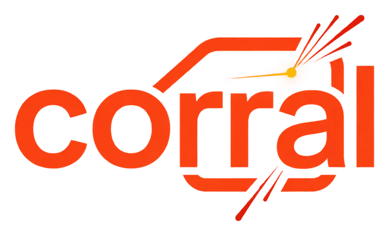

<p align="center">
  
</p>

# corral

corral is an open-source MongoDB wire-protocol proxy that gives connection
pooling to clients that cannot pool themselves. The motivating case is the
MongoDB PHP driver under PHP-FPM, where every worker holds its own persistent
connection. corral accepts many client connections and multiplexes them over a
small, bounded pool of upstream connections.

Status: early development. The proxy core is built: corral pools upstream
connections for replica sets and sharded clusters (through `mongos`), with
optional TLS on both sides, SCRAM authentication to the upstream, and logging,
metrics, tracing and an admin listener. It has not yet been used in production.

License: Apache-2.0 (see `LICENSE`).

## Build and test

Requires Go (see `go.mod`).

- `make build` builds `bin/corral`.
- `make test` runs `go vet` and the unit and integration tests.
- `make test-functional` runs the binary-level tests (builds first).

## Running

```
make build
./bin/corral -log.level=info -admin.listen=127.0.0.1:9187
```

`SIGINT` or `SIGTERM` triggers a graceful shutdown. See the operations guide
below for settings and exit codes.

The admin listener has no authentication or TLS; read Security and operational warnings before binding a non-loopback address.

## Documentation

- [Observability and operations](docs/operations/observability.md): settings,
  admin endpoints, logging, tracing and security notes.
- Architecture decisions: `docs/adr/`.
